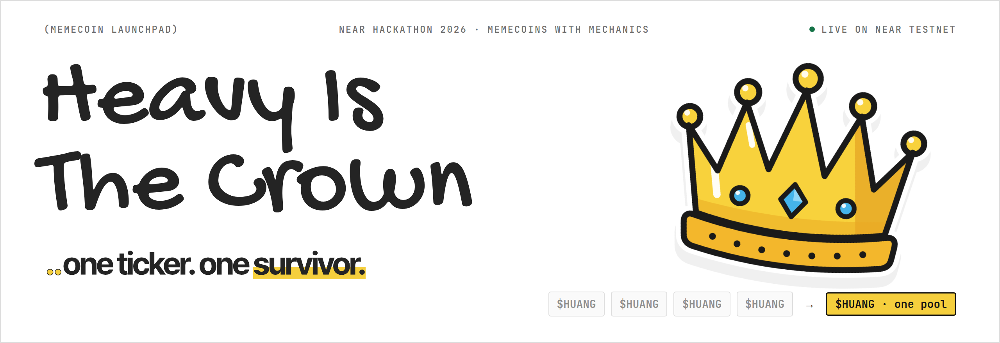
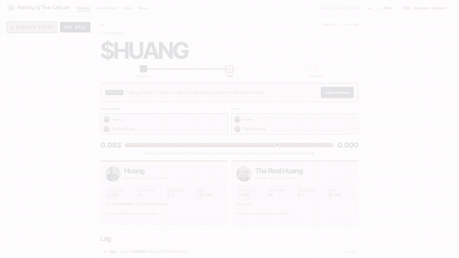
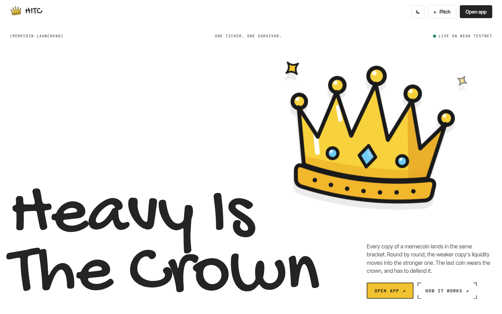
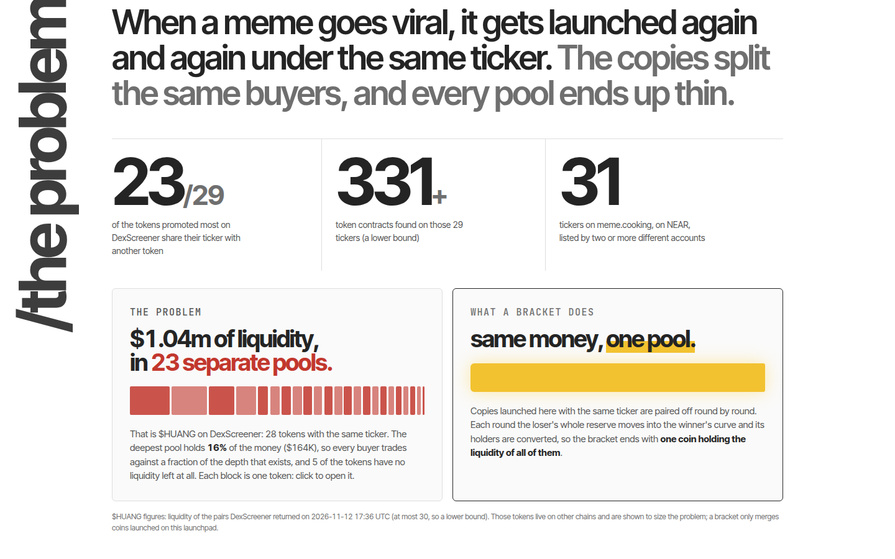
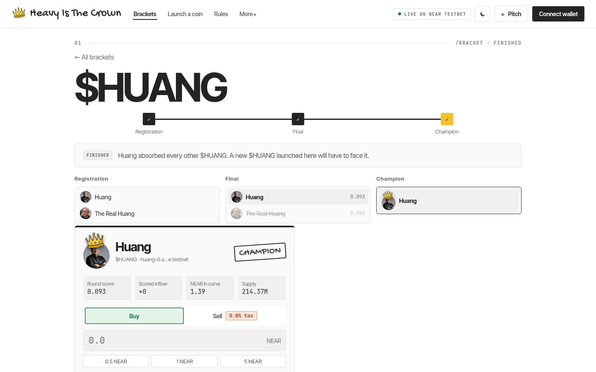
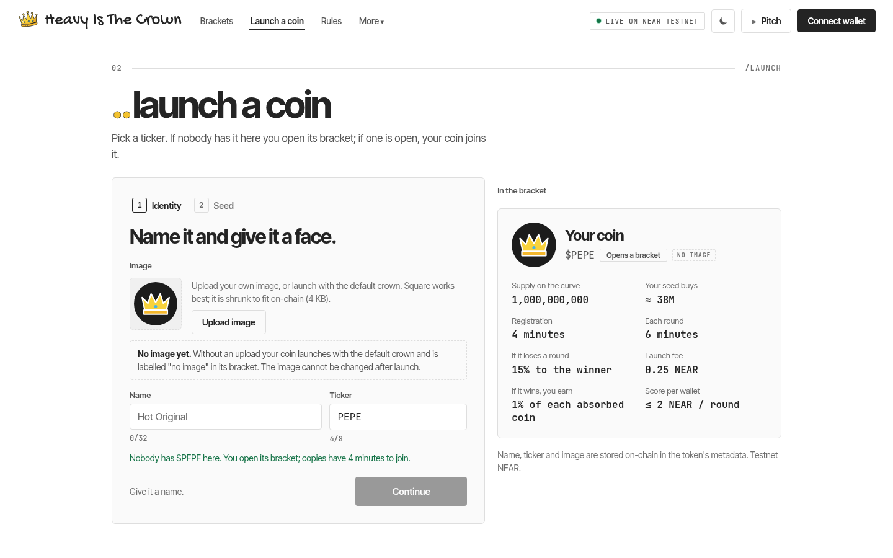
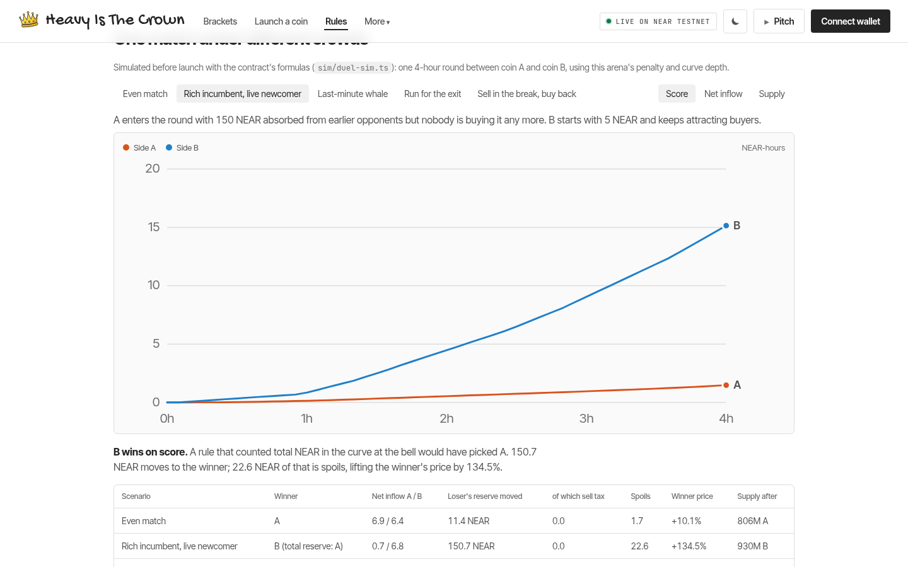
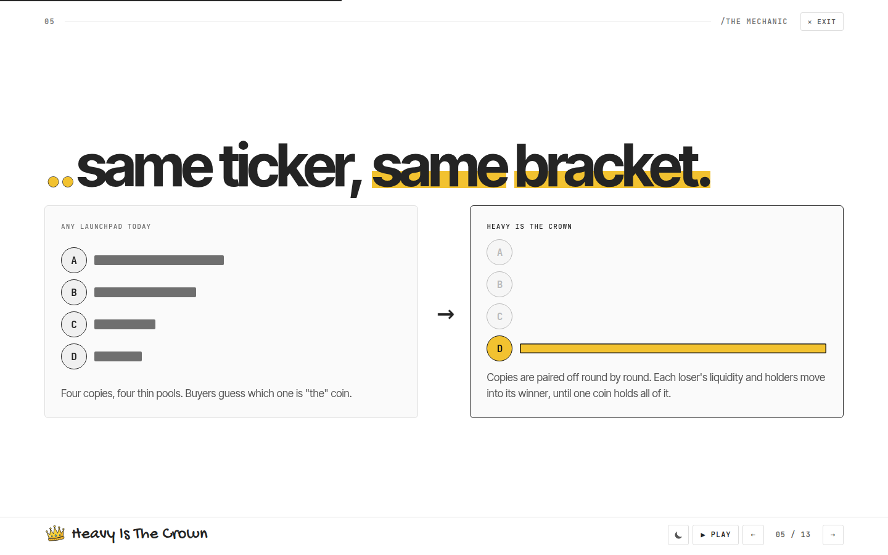

<div align="center">


# Heavy Is The Crown



<p>
  <a href="https://cookiez-1909.github.io/Heavy-Is-The-Crown/"></a>
  <a href="https://testnet.nearblocks.io/address/arena-33881.memeduel-4a2d2e.testnet"></a>
  <a href="#run-it"></a>
  <a href="#where-the-rules-live"></a>
  <a href="https://nearhackathon.com"></a>
</p>

<a href="https://github.com/cookiez-1909/Heavy-Is-The-Crown/actions/workflows/ci.yml"></a>

</div>

**Every coin with the same ticker lands in the same bracket. Each round the weaker copy's liquidity moves into the stronger one, until a single coin holds all of it.** Heavy Is The Crown (HITC) is a memecoin launchpad on NEAR built around that one rule.

Built at NEAR HACKATHON for the **Memecoins With Mechanics** track. Testnet prototype, not audited.

## HITC in 60 seconds

- **The problem.** Launching a memecoin takes one click, so anything that goes viral is launched again and again under the same ticker. On DexScreener, at least 25 tokens called HUANG were launched within 24 hours, and 23 of the 29 most promoted tokens shared their ticker with another token. The copies split the same buyers and every pool stays thin.
- **What HITC does.** The first coin of a ticker opens a bracket; every copy launched during registration joins it. Copies are paired off round by round, scored on new money weighted by how long it stays. The loser's reserve moves into the winner and its holders are converted, so the bracket ends with one coin holding the liquidity of all of them. The champion has to defend the ticker against later copies.
- **What NEAR does.** Every coin is its own NEP-141 running one token code pinned by hash (a global contract), so a launch costs 0.25 NEAR. Settling a match is a chain of cross-contract calls between the two tokens. The arena account has no access keys, so nobody can change the rules.
- **What it does not do.** It only merges coins launched here, it counts NEAR rather than people, and the sell tax discourages running before the bell without preventing it. See [Known limits](#known-limits).
- **Check it yourself.** Every figure links to its source: `node scripts/dexscreener.mjs` and `node scripts/radar.mjs` redo the counts, and `get_config` on the arena returns every rule.

| | |
| --- | --- |
| Hosted app and pitch deck | [cookiez-1909.github.io/Heavy-Is-The-Crown](https://cookiez-1909.github.io/Heavy-Is-The-Crown/), on the fast test arena (6 min registration, 9 min rounds) so a two-coin bracket finishes in about 15 minutes. Connect a NEAR testnet wallet to launch or trade. Republish with `scripts/publish-pages.sh` |
| Arena a local clone uses by default (1 h registration, 4 h rounds) | [`arena-33881.memeduel-4a2d2e.testnet`](https://testnet.nearblocks.io/address/arena-33881.memeduel-4a2d2e.testnet) |
| Demo arena (4 min registration, 6 min rounds), where the demo video's $HUANG bracket was played | [`arena-86517.memeduel-4a2d2e.testnet`](https://testnet.nearblocks.io/address/arena-86517.memeduel-4a2d2e.testnet) |
| The two $HUANG coins of that bracket: the champion and the copy it absorbed | [`huang-0.arena-86517…`](https://testnet.nearblocks.io/address/huang-0.arena-86517.memeduel-4a2d2e.testnet), [`huang-1.arena-86517…`](https://testnet.nearblocks.io/address/huang-1.arena-86517.memeduel-4a2d2e.testnet) |
| Token code every coin runs (global contract hash) | `3wVfmENz9jKGRHTkskMQADqkyjjzbEPCvBkQi9jromEU` |

All test arenas are listed in [Live on testnet](#live-on-testnet).

## One bracket, start to finish

<div align="center">

<br /><sub>The bell on the $HUANG demo bracket: anyone settles the match, the copy's liquidity moves into the winner, and the crown drops. Real testnet transactions; the waits are sped up.</sub>
</div>

<table>
  <tr>
    <td width="50%"><br /><sub><b>Landing page.</b> The rule first, then the problem with numbers you can click through to their source.</sub></td>
    <td width="50%"><br /><sub><b>The problem, measured.</b> DexScreener and meme.cooking counts; every block and dot links to the token or listing it stands for.</sub></td>
  </tr>
  <tr>
    <td width="50%"><br /><sub><b>A bracket.</b> Rounds, scores, the champion, and a trade box with the live sell tax on every coin.</sub></td>
    <td width="50%"><br /><sub><b>Launch.</b> Upload an image or keep the default crown, and see which bracket your coin joins before you pay.</sub></td>
  </tr>
  <tr>
    <td width="50%"><br /><sub><b>Rules.</b> Every parameter read live from the arena, and the simulated match under five different crowds.</sub></td>
    <td width="50%"><br /><sub><b>Pitch deck.</b> 13 slides at <code>/pitch/</code>, built from the same data as the site.</sub></td>
  </tr>
</table>

## Try it in 3 minutes

Nothing to install or clone: open **[cookiez-1909.github.io/Heavy-Is-The-Crown](https://cookiez-1909.github.io/Heavy-Is-The-Crown/)**. The hosted app runs on the fast test arena (6 min registration, 9 min rounds).

**Without a wallet.** Open **Brackets → $HUANG** to see a finished bracket: the final, the champion, the copy it absorbed, and every trade in the on-chain log. **Rules** shows every parameter read live from the arena. The pitch deck is at [`/pitch/`](https://cookiez-1909.github.io/Heavy-Is-The-Crown/pitch/).

**With a testnet wallet, dethrone a champion on your own.** One wallet is enough, because a new coin with a ticker that already has a champion is matched against that champion.

1. **Get a testnet account.** If your NEAR wallet supports testnet (Meteor, Intear), use it. Otherwise create one from a terminal; the faucet pays for the account:

   ```bash
   npm install -g near-cli-rs
   near account create-account sponsor-by-faucet-service <your-name>.testnet autogenerate-new-keypair print-to-terminal network-config testnet create
   ```

   Then in Meteor switch the network to Testnet, choose **Import an existing wallet → Private key**, and paste the `ed25519:…` private key the command printed. More testnet NEAR: the [NEAR faucet](https://docs.near.org/getting-started/faucet) sends 5 NEAR per request.
2. **Connect wallet** on the site.
3. **Launch a coin with the ticker `HUANG`.** $HUANG already has a champion, so your coin opens season 2 and the champion is entered against it automatically. It costs 0.25 NEAR plus a seed of at least 0.2 NEAR; the risk dialog lists exactly what leaves your wallet. If someone else's $HUANG season is already past registration, the ticker is locked until it ends: pick another ticker that has a champion, such as `LION`, `CROWN` or `WAGMI`.
4. **After the 6-minute registration, press Start the next round** (anyone can, and is paid a small bounty). Then **buy your own coin**: in a round only new money scores, so both coins start from zero.
5. **At the bell, 9 minutes later, press Settle matches, then Crown the champion.** If your coin scored more, the old champion's liquidity is now in your curve and its holders hold your token.

## The problem

Launching a memecoin is one click, so anything that goes viral gets launched many times: same name, same picture, same ticker. Traders call it PVP. The copies split the same buyers and most of them die with the liquidity still inside.

**Across chains (DexScreener).** We took DexScreener's own "top boosts" list, the tokens being promoted the most, and searched each ticker. On 2026-11-12 17:36 UTC, **23 of the 29 promoted tokens shared their ticker with at least one other token, 13 of them with nine or more others**: at least 331 distinct token contracts on 29 tickers (175 on Solana, 46 on Robinhood Chain, 12 on BNB Chain). HUANG alone returned 28 different tokens. A second search on 2026-11-13 16:12 UTC, which also records when each pool was created, shows **at least 25 tokens called HUANG launched within 24 hours** (pools created between 12 Nov 14:33 and 13 Nov 11:42 UTC, on Robinhood Chain, Solana and Arc); the raw response is in `scripts/snapshots/dexscreener-search-huang-2026-11-13T1612Z.json` (`pairCreatedAt` on each pair; rerun with `curl 'https://api.dexscreener.com/latest/dex/search?q=Huang'`).

- `node scripts/dexscreener.mjs` reruns it and prints, for each ticker, the search URL that returns those tokens. No API key.
- On the home page and in the pitch deck each dot is one token contract and links to it on DexScreener.
- The tickers are not hand-picked: the list is whatever DexScreener is promoting when the script runs, so the numbers move during the day.
- A search returns at most 30 pairs, so the counts are lower bounds (14 of the 29 searches hit the cap).
- Sharing a ticker does not prove a token is a copy. Short generic tickers such as MAX or ZEN include unrelated projects.
- Promoted tokens are not a random sample of all tokens.

**On NEAR (meme.cooking).** meme.cooking shows it happening on NEAR. On 2026-11-12, **31 tickers there had been listed by two or more different accounts: 80 of the 591 listings the site displays (14%)**. HOT was listed by 5 accounts, COOKED by 4, and SHIT, BATMAN, CHILL, MNGA, MINIROOT, SOON and HIJACK by 3 each.

Every one of those numbers can be checked by hand:

- `node scripts/radar.mjs` prints each contested ticker with a `meme.cooking/meme/<id>` link per listing.
- On the home page each dot is one listing and links to its page on meme.cooking.
- Or type a ticker into meme.cooking's search and count the cards with that `$TICKER` (the search also matches names and descriptions, so read the ticker on the card).

What the count includes and leaves out:

- It counts only what meme.cooking displays, which is listings that hold a deposit: 591 of the 2,321 its API returns. The other 1,730 are empty listings the site hides; 572 of them come from one account.
- Most displayed listings never reached their soft cap. Of the 267 that launched, 37 share a ticker with another launched coin.
- A ticker listed several times by a single account is not counted.
- This is one launchpad on one chain, and 14% is a modest share. The cross-chain picture is the DexScreener count above.

## The mechanic

1. **One bracket per ticker.** The first coin launched with a ticker opens its bracket and a registration window. Every coin launched with that ticker during registration joins it (up to 8). After registration the ticker is locked.
2. **Creators post a seed, one coin each.** The seed buys the creator's first tokens from the coin's own bonding curve, so it is at stake like everyone else's money. One account can launch only one coin per bracket.
3. **Seeding by score.** When a round closes, the arena ranks the survivors by score and pairs best against worst. With an odd number the top seed gets a bye.
4. **Score = new NEAR × time.** Each round a coin scores only the NEAR that came in since the round started, for as long as it stays. Net outflow scores negative. Each wallet's net inflow counts for at most 2 NEAR per round on the live arena, and trades made between rounds count towards the next round. Buys during registration only decide the first pairing: every coin starts round 1 from zero.
5. **Selling is taxed and the tax stays in the curve.** It ramps from 0 to the penalty over the round. After a win it restarts at the penalty and decays.
6. **At the bell trading freezes.** Anyone settles a match and is paid 1% of the loser's reserve (at most 0.05 NEAR). The two tokens compare scores themselves.
7. **The loser is absorbed.** 15% of its reserve is the penalty: 1% is paid to the creator of the winning coin, and 14% enters the winner's curve with no tokens minted (spoils). The other 85% buys winner tokens, which the loser's holders claim pro rata by burning their dead coin.
8. **The champion defends.** A later coin with the same ticker opens a new season, and the reigning champion is entered in it automatically. There is never a second living coin with that ticker here.

Each coin is its own NEP-141 token with its own constant-product curve: buying mints, selling burns.

## Why launch here

- **For the original, it is a shield.** Once a coin is champion, every later copy of its ticker has to beat it first. A copy that loses brings its liquidity and holders into the champion, and 1% of what it brings goes to the champion's creator. Copies feed the original instead of splitting its buyers.
- **For holders of a losing copy, most of the money comes along.** About 85% of the losing coin's liquidity comes back to its holders as the winner's tokens.
- **For traders, one pool.** A finished bracket leaves one coin per ticker, holding the liquidity of all of them.

What this does not change: only coins launched here are in a bracket, and nothing forces anyone to launch here.

## Exploits considered, and what the contracts do about them

| Attack | Counter | Where |
|---|---|---|
| Run before the bell to dodge the loser's penalty | Sell tax ramps to exactly the penalty at the bell; the tax stays in the curve and moves to the winner | `sell_tax_bps` in the token |
| Winners dump on holders who were just converted in | Sell tax restarts at the penalty at the moment of the win and decays over the cooldown | `book_win`, `sell_tax_bps` |
| Snowball: win round 2 on liquidity absorbed in round 1 | Score counts only inflow since the round started | `record_flow`, `start_round` |
| Sell in the break, buy back after the start to fake inflow | Trades during the break count towards the next round, so the sale cancels the buy-back | `flow_round` |
| One whale carries a coin | Inflow is weighted by how long it stayed, and each wallet's net inflow counts for at most `score_cap` per round | `record_flow`, `touch_score` |
| Stuff the bracket with empty copies | One coin per account per bracket, a bonded seed per coin that flows to whoever beats it, pairing computed by the contract | `enter`, `on_results` in the arena |
| Open a second bracket for the same ticker | Ticker is normalised and maps to one live tournament | `by_ticker` in the arena |
| Nobody settles, bracket stalls | Settle and advance are open to anyone and pay a bounty | `settle`, `advance` |
| Deployer swaps the arena code | The arena has no owner, and the deploy script deletes its only access key | `scripts/deploy.sh` |

None of these is a complete defence; see Known limits.

## Where the rules live

- `contracts/token`: the NEP-141. Curve, mint, burn, score, sell tax, freeze, settle, absorb, claim.
- `contracts/arena`: launch, one-bracket-per-ticker, seeding, round clock.

There is no owner, no admin method and no upgrade path in either contract. All parameters are fixed in the arena's `new` and readable through `get_config` (arena) and `get_info` (token). The only thing the arena can tell a token is who its next opponent is. The web app has no backend: it reads the RPC and sends wallet transactions.

**NEAR's role, concretely:** NEP-141/145/148 tokens; global contracts (NEP-591) so every coin runs the same code pinned by hash and a launch costs 0.25 NEAR instead of ~2.3 NEAR of code storage; named sub-accounts (`pepe-0.<arena>`); cross-contract promises with callbacks and rollback for settle → absorb → claim → transfer; an account with no access keys as the "no admin" guarantee.

**Partner tech:** meme.cooking's API for the contested-ticker data; HOT's `@hot-labs/near-connect` for wallets.

## Live on testnet

Every arena below runs with a 15% penalty, 5 NEAR virtual liquidity, a 0.2 NEAR minimum seed and up to 8 coins per bracket. None of them has an access key.

| Arena | Registration / round / post-win tax decay | Score cap, creator reward | Token code | Used for |
|---|---|---|---|---|
| `arena-33881.memeduel-4a2d2e.testnet` | 1 h / 4 h / 1 h | 2 NEAR, 1% | `3wVfmE…` | the web app's default |
| `arena-35900.memeduel-4a2d2e.testnet` | 6 min / 9 min / 3 min | 2 NEAR, 1% | `3wVfmE…` | the hosted app, fast testing |
| `arena-86517.memeduel-4a2d2e.testnet` | 4 min / 6 min / 2 min | 2 NEAR, 1% | `3wVfmE…` | the demo video's $HUANG bracket |
| `arena-83503.memeduel-4a2d2e.testnet` | 4 min / 6 min / 2 min | 2 NEAR, 1% | `3wVfmE…` | an earlier take of the video |
| `arena-32526.memeduel-4a2d2e.testnet` | 1 h / 4 h / 1 h | none | `5LpgXe…` | previous token code |
| `arena-82872.memeduel-4a2d2e.testnet` | 6 min / 9 min / 2.4 min | none | `5LpgXe…` | previous token code, an earlier video's $HOT and $KEK brackets |

Token code hashes: `3wVfmENz9jKGRHTkskMQADqkyjjzbEPCvBkQi9jromEU` (current) and `5LpgXeEtrkB1QUWRU9Q8oeJwyL3Q8wBkDbQdK7pfAHsC` (previous, without the per-wallet score cap and the creator reward).

## Simulation

One 4-hour match between coin A and coin B, with the contract's formulas (`sim/duel-sim.ts`). 15% penalty and 5 NEAR virtual liquidity, as on every arena above (the Rules page shows the same table):

| Scenario | Reserve at start (A / B) | Net inflow at bell (A / B) | Score, NEAR-hours (A / B) | Winner | Total-reserve rule would pick | Loser's reserve moved | of which sell tax | Spoils | Winner price bump | Supply after |
|---|---|---|---|---|---|---|---|---|---|---|
| Even match | 5 / 5 | 6.9 / 6.4 | 15 / 14 | **A** | A | 11.4 NEAR | 0.0 | 1.7 | +10.1% | 806M A |
| Rich incumbent, live newcomer | 150 / 5 | 0.7 / 6.8 | 1 / 15 | **B** | A ⚠ | 150.7 NEAR | 0.0 | 22.6 | +134.5% | 930M B |
| Last-minute whale | 5 / 5 | 6.9 / 21.6 | 15 / 7 | **A** | B ⚠ | 26.6 NEAR | 0.0 | 4.0 | +23.6% | 858M A |
| Run for the exit | 20 / 20 | 6.4 / -17.7 | 18 / -16 | **A** | A | 2.3 NEAR | 2.3 | 0.4 | +1.1% | 850M A |
| Sell in the break, buy back | 5 / 5 | 0.5 / 4.2 | -1 / 9 | **B** | A ⚠ | 25.5 NEAR | 0.0 | 3.8 | +27.0% | 840M B |

Shorter rounds make a late whale cheaper. In the whale row A collected 6.9 NEAR over the round and scored 14.8 NEAR-hours, so without a cap a single buy 30 minutes before the bell would beat it with about 30 NEAR. With the live arena's 2 NEAR per-wallet cap, one wallet adds at most 1 NEAR-hour that late, so overtaking A that way takes about 15 funded wallets. We chose 4-hour rounds so a bracket of 8 finishes in about 13 hours.

What is left of a stake that keeps landing on the losing side:

| Penalty per round | lost 1 round | lost 2 rounds | lost 3 rounds |
|---|---|---|---|
| 10% | 90% | 81% | 73% |
| 15% | 85% | 72% | 61% |
| 30% | 70% | 49% | 34% |

15% was chosen because a bracket of 8 has three rounds: at 30% a holder who is converted three times keeps a third.

```bash
node sim/run.ts --sweep
```

prints the tables for 10%, 15% and 30%, and the 15% case without the sell tax (Node 24). The Rules page draws each scenario.

## Run it

Requirements: Rust with the `wasm32-unknown-unknown` target, `cargo-near`, Node 24, pnpm.

```bash
scripts/build.sh
```

```bash
cargo test
```

`cargo test` runs 17 unit tests on the token and 3 end-to-end tests on a local NEAR sandbox (`tests/tests/duel.rs`): a 4-coin bracket through semi-finals and final, chained conversion of a holder through two lost coins, a second season against the champion, a 3-coin bracket with a bye, and the limits and access-control paths. The first run downloads the sandbox binary. If a sandbox test fails with "Failed to bind to available ports", the sandboxes raced for ports: run `cargo test -- --test-threads=1`.

To look at the UI against real contract state without any testnet funds:

```bash
cargo run -p duel-tests --example localnet
```

It starts a local chain, deploys everything, plays a PEPE bracket into its final, finishes a KEK bracket and opens a DOGE registration, then prints two lines to put in `web/.env.local`. Then:

```bash
cd web && pnpm install && pnpm dev
```

Wallets cannot sign on a sandbox, so the local chain is read-only from the browser. `web/.env.example` shows how to point the app at the testnet arena above. To deploy your own:

```bash
scripts/deploy.sh <your-account.testnet> 1 4 1
```

(registration, round and cooldown in hours; further arguments are penalty in bps, virtual NEAR, minimum seed, bracket size, creator reward in bps and the per-wallet score cap in NEAR). The script publishes the token code as a global contract only if that code hash is not on chain yet, because publishing burns about 23 NEAR.

## Known limits

- **Only coins launched here are in the bracket.** Copies on other launchpads are out of reach.
- **Score counts NEAR, not people.** One wallet counts for at most 2 NEAR per round, but a group of wallets, or one person with several, can pool money to carry a coin. Each extra wallet pays its own storage and fees; nothing checks who is behind it.
- **The sell tax does not force anyone to stay.** It makes leaving before the bell no cheaper than losing. In "Run for the exit" nearly all of the loser's liquidity still leaves and the winner receives only the tax.
- **Spoils are locked liquidity, not a payout.** They lift the winner's price, but holders can withdraw only part of them; the rest stays in the curve as a floor.
- **Bracket slots are finite.** Filling the remaining slots with copies from several wallets to shut a rival out costs one wallet, one fee and one seed per slot. It is made expensive, not prevented: those seeds flow to whoever beats the copies.
- **The build is not reproducible.** Contracts are built with `cargo near build non-reproducible-wasm`, so rebuilding from this repo on another machine gives different bytes than the code hash deployed on testnet. You can check that the arena has no keys and which code hash every coin runs, but not, by rebuilding, that the hash matches this source. `cargo near build reproducible-wasm` (Docker) would fix this.
- **The first coin of a ticker picks the timing.** Registration starts when it launches.
- **Byes can repeat.** With an odd number of coins the top seed skips the round, and seeding uses each coin's score in the previous round, including a round it skipped. A coin that keeps drawing the most money can get a bye again; in a bracket of 5 it can reach the final without playing a match. Forbidding two byes in a row would fix it in the arena.
- **A lost `start_round` message stalls a token** until anyone calls `resync` on the arena. Covered by a guard in `advance`, not by a sandbox test.
- **Not audited.** Hackathon code.
- Each trade pays a flat 0.002 NEAR that stays in the token contract to pay for the on-chain log; a first-time buyer also pays 0.00125 NEAR of NEP-145 storage.
- `storage_unregister(force=true)` is disabled, because burning outside the curve would break claim accounting.
- Publishing a new token code version as a global contract burns about 23 NEAR.
- The simulation models each side's crowd as one flow, so it does not show the per-wallet cap.

## After the hackathon

One possible path, nothing more: the arena is just a contract, so an existing launchpad such as meme.cooking could route launches that reuse a live ticker into a bracket instead of listing them side by side. Nobody has agreed to this. Before mainnet the contracts would need a reproducible build and an audit.

## Layout

```
contracts/token      NEP-141 with the bracket mechanic
contracts/arena      launchpad: one bracket per ticker, seeding, round clock
contracts/publisher  helper that publishes a wasm as a global contract (tests only)
tests                sandbox end-to-end tests and the localnet example
sim                  parameter simulation
web                  Vite + React front end
scripts              build, deploy, publish the site to gh-pages, DexScreener and meme.cooking counts
scripts/snapshots    raw API responses behind the figures in this README
docs/readme          banner, GIF and screenshots used here
```

## Credits

Demo video music: Jacques Offenbach, can-can from the overture to "Orpheus in the Underworld", recording by Musopen, public domain (https://commons.wikimedia.org/wiki/File:Offenbach_-_Orpheus_in_the_Underworld_-_Overture,_Can_Can_section.ogg). Narration is synthesized.

## License

MIT, see [LICENSE](LICENSE).
